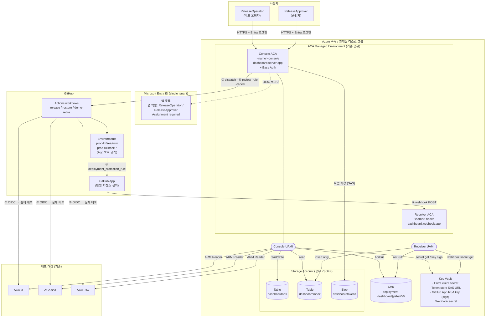
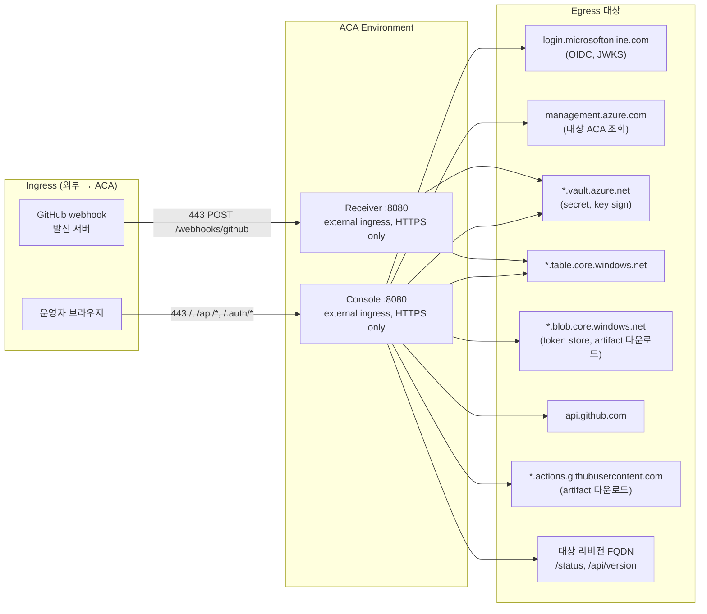
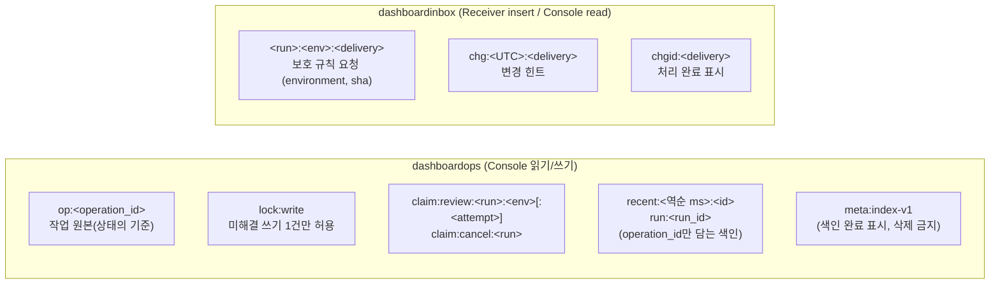

# 1. 시스템 아키텍처

관제실은 **두 개의 Azure Container App**(Console, Receiver)과 이를 지원하는 Storage·Key Vault·관리 ID,
그리고 **Microsoft Entra ID**(사용자 인증)와 **GitHub**(App·Actions·Environments)로 구성됩니다.
두 앱은 **같은 이미지 digest**를 사용하지만 실행 모듈·관리 ID·권한이 다릅니다.

## 1.1 전체 구성도

번호는 [4장 배포·승인 흐름](04-operation-flows.md#41-배포-요청--지역-승인-end-to-end)의 단계와 대응합니다.

## 1.2 구성요소별 책임

| 구성요소 | 책임 | 하지 않는 것 |
| --- | --- | --- |
| **Console ACA** | 운영자 UI, `/api/dashboard`(조회), `/api/changes`(SSE 변경 스트림), `/api/operations`(요청), `/api/operations/{id}/review`(승인/거부). GitHub 설치 토큰 발급(Key Vault 서명). Azure 대상 앱 상태 조회 | Azure 대상 앱 변경, 웹훅 수신 |
| **Easy Auth (Console 앞단)** | Entra OIDC 로그인, 미인증 요청을 로그인 페이지로 리다이렉트, 토큰을 Blob token store에 저장, 헤더로 앱에 사용자 정보 전달 | 역할 판단(앱이 직접 수행) |
| **Receiver ACA** | `/webhooks/github`에서 HMAC 서명 검증 후 보호 규칙 요청과 변경 힌트를 Inbox에 **추가** | GitHub API 호출, 운영 테이블 접근, 서명 키 접근, Easy Auth(웹훅 경로는 인증 미적용) |
| **Table `dashboardops`** | 작업 감사 기록, 단일 쓰기 잠금, 중복 결정 방지 | — |
| **Table `dashboardinbox`** | 서명 검증된 보호 규칙 요청 / 변경 힌트 | — |
| **Blob `dashboardtokens`** | Easy Auth token store (refresh token 포함) | 공개 접근 |
| **Key Vault** | 비밀 3종 + GitHub App RSA 키(앱은 **서명만** 가능, 키 원문은 나가지 않음) | — |
| **GitHub App** | Environment 보호 규칙 제공자, 설치 토큰으로 Actions API 호출 | Azure 접근 |
| **GitHub Actions workflow** | OIDC로 Azure 로그인 후 실제 배포·복구·retire (snapshot·카나리·health gate) | 관제실 상태 저장 |
| **대상 ACA (kr/sea/usw)** | 배포 대상 앱. Console MI에 `Reader`만 부여 | — |

## 1.3 네트워크 · 호출 방향

운영자가 방화벽·NSG·Private Endpoint를 설계할 때 필요한 **들어오는(Ingress)·나가는(Egress)** 호출입니다.

| 경로 | 설명 | 근거 |
| --- | --- | --- |
| 브라우저 → Console | `https://<name>-console.<env 기본 도메인>`. `allowInsecure: false`, Easy Auth `requireHttps` | `dashboard.bicep` |
| GitHub → Receiver | `https://<name>-hooks.../webhooks/github` (템플릿 출력 `githubCallback`). Easy Auth 없음, HMAC 서명으로 보호. 본문 최대 1 MiB | `webhook.py` |
| Console → ARM | `GET /subscriptions/.../containerApps/{app}`, `/revisions`, `/revisions/{rev}/replicas` (api-version `2024-03-01`). 페이지 링크가 `management.azure.com` 밖이면 거부 | `observations.py` |
| Console → 대상 리비전 | 리비전 전용 FQDN의 `/status`, `/api/version`을 3초 타임아웃으로 표본 조회(레플리카 표본). 대상 앱이 internal ingress면 표본은 비어 있게 됨 | `observations.py` |
| Console → GitHub | `api.github.com` (설치 토큰, runs/jobs/pending/artifacts, dispatch, cancel, protection rule). artifact zip은 302 리다이렉트로 `*.blob.core.windows.net` 또는 `*.actions.githubusercontent.com`만 허용 | `github.py`, `evidence.py` |
| Console → Entra | JWKS(`/discovery/v2.0/keys`)로 ID token 서명 검증 | `auth.py` |
| 두 앱 → Key Vault/Storage | 관리 ID 토큰으로 접근. Storage는 `allowSharedKeyAccess: false` | `dashboard.bicep` |

> ⚠️ **사설 네트워크는 템플릿 범위 밖입니다.** `infra\dashboard.bicep`은 VNet·Private Endpoint·Private DNS를 만들지 않고, Storage `publicNetworkAccess`도 설정하지 않습니다. 운영 환경에서는 ACA 환경 VNet에 Blob/Table(필요 시 Key Vault) Private Endpoint와 DNS를 별도로 구성하고, 템플릿 재배포 전에 `publicNetworkAccess: 'Disabled'`를 맞춘 뒤 사설 경로를 검증합니다([7장 사전 준비](../07-deployment-dashboard.md#사전-준비)).

## 1.4 리소스별 주요 설정

### Container Apps

| 항목 | Console (`<name>-console`) | Receiver (`<name>-hooks`) |
| --- | --- | --- |
| 이미지 | ACR `deployment-dashboard@sha256:...` (digest 고정, 두 앱 동일) | 동일 |
| 실행 인자 | `dashboard.server:app --port 8080` | `dashboard.webhook:app --port 8080` |
| 컨테이너 사용자 | `10001:10001` (non-root, `python:3.13-slim`) | 동일 |
| Ingress | external, targetPort 8080, HTTP 비허용 | 동일 |
| Revision 모드 | Single | Single |
| 스케일 | min 1 / max 3 | min 1 / max 2 |
| 리소스 | 0.5 vCPU / 1 GiB | 0.25 vCPU / 0.5 GiB |
| Probe | Readiness `GET /healthz` 10초 | 동일 |
| ID | Console UAMI (user-assigned) | Receiver UAMI |
| ACA secret (Key Vault 참조) | `entra-client-secret`, `token-store-sas` | `github-hook-secret` |
| Easy Auth | 사용 (아래 표) | **미사용** |

### 환경 변수

| 변수 | Console | Receiver | 값 / 검증 |
| --- | :-: | :-: | --- |
| `DASHBOARD_REPO` | ✓ | ✓ | `owner/repo` |
| `DASHBOARD_REPO_ID` | ✓ | ✓ | 숫자 repository ID |
| `DASHBOARD_INSTALLATION_ID` | ✓ | ✓ | 숫자 App installation ID |
| `DASHBOARD_TABLE_ENDPOINT` | ✓ | ✓ | `https://<account>.table.core.windows.net` 형식만 허용 |
| `DASHBOARD_MI_CLIENT_ID` | ✓ | ✓ | 각자의 UAMI client ID |
| `DASHBOARD_TENANT_ID` | ✓ | | Entra tenant GUID |
| `DASHBOARD_ENTRA_CLIENT_ID` | ✓ | | Entra 앱 client ID (ID token audience) |
| `DASHBOARD_ORIGIN` | ✓ | | `https://<console fqdn>` (경로 없음). 쓰기 요청의 `Origin` 검사에 사용 |
| `DASHBOARD_APP_CLIENT_ID` | ✓ | | GitHub App **client ID** (JWT `iss`) |
| `DASHBOARD_SIGNING_KEY` | ✓ | | **버전 포함** Key Vault key URI만 허용 |
| `DASHBOARD_TARGETS` | ✓ | | `{"kr","sea","usw"}` 세 개의 Container App 리소스 ID(JSON) |
| `DASHBOARD_WEBHOOK_SECRET` | | ✓ | `secretRef: github-hook-secret`, 32바이트 이상이어야 기동 |

값이 형식에 맞지 않으면 앱이 **기동 시 실패**합니다(`config.py`). 리비전이 Unhealthy이면 먼저 이 값을 확인합니다.

### Easy Auth (`authConfigs/current`)

| 설정 | 값 |
| --- | --- |
| 미인증 요청 | `RedirectToLoginPage` → `azureactivedirectory` |
| Issuer | `https://login.microsoftonline.com/<tenant>/v2.0` |
| Allowed audience | Entra 앱 client ID |
| Client secret | ACA secret `entra-client-secret` (Key Vault 참조) |
| 로그인 scope | `openid profile offline_access` (refresh token 확보) |
| Token store | Blob, `sasUrlSettingName: token-store-sas` |
| HTTPS | `requireHttps: true` |

### Storage Account

| 설정 | 값 | 이유 |
| --- | --- | --- |
| `allowSharedKeyAccess` | `false` | 계정 키 대신 Entra RBAC만 사용 |
| `allowBlobPublicAccess` | `false` | token store 보호 |
| `defaultToOAuthAuthentication` | `true` | 포털 등에서도 OAuth 기본 |
| `minimumTlsVersion` | `TLS1_2` | — |
| Tables | `dashboardops`, `dashboardinbox` | 파티션 키 = repository ID |
| Blob container | `dashboardtokens` (`publicAccess: None`) | 사용자 위임 SAS(`rwd`, 최대 7일)로만 접근 |

### Table 행 구조 (파티션 = repository ID)

`op:` 생성·`lock:write` 생성·`recent:` 생성은 **하나의 엔터티 트랜잭션**으로 처리되고, 완료 시 `op:` 갱신·`claim:` 생성·`run:` 색인·잠금 해제가 다시 하나의 트랜잭션(ETag 조건부)으로 처리됩니다. 상태는 항상 `op:` 행을 기준으로 합니다.

다음: [2. 플랫폼 구성 (Azure · Entra · GitHub)](02-platform-configuration.md)
