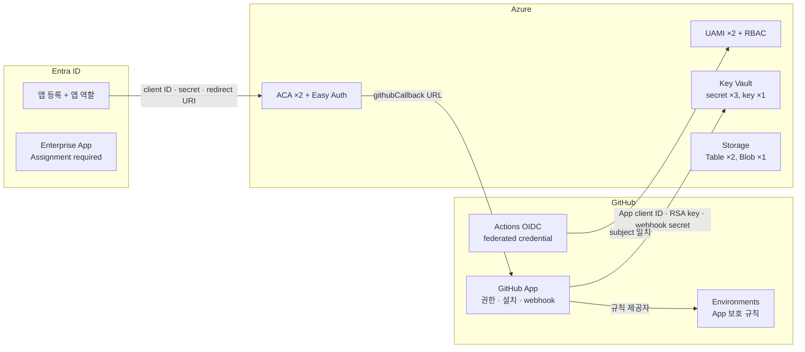
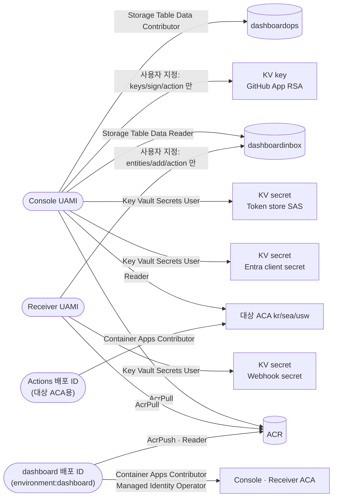
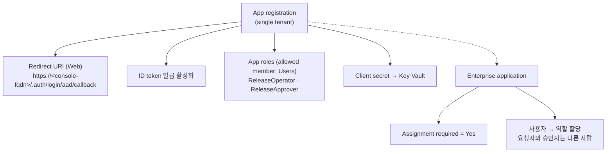
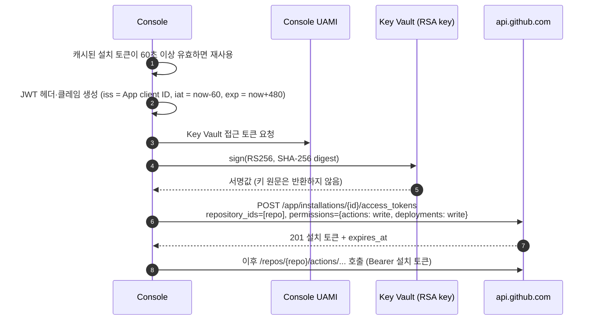
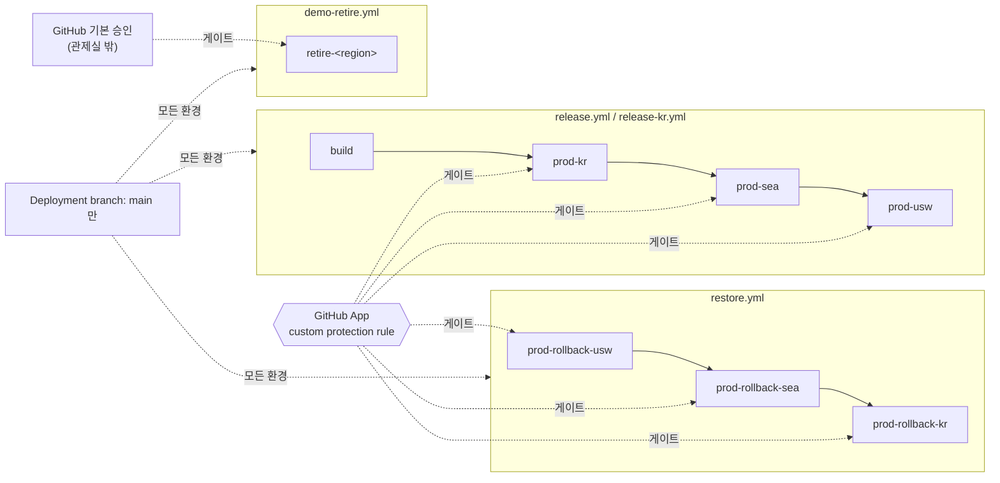

# 2. 플랫폼 구성 (Azure · Entra · GitHub)

관제실이 동작하려면 세 플랫폼의 설정이 서로 맞물려야 합니다. 이 장은 플랫폼별로
**무엇을 설정하는지 / 어떤 값을 쓰는지 / 왜 필요한지 / 어떻게 확인하는지**를 정리합니다.
권한 할당·회수 절차의 원본은 [8장 권한 체크리스트](../08-deployment-dashboard-permissions.md)입니다.

## 2.1 Azure 구성

### 2.1.1 리소스 체크리스트

| # | 리소스 | 설정 핵심 | 확인 방법 |
| --- | --- | --- | --- |
| 1 | ACA Managed Environment | 기존 환경 재사용(`managedEnvironmentId`). 기본 도메인이 `DASHBOARD_ORIGIN`에 사용됨 | `az containerapp env show` |
| 2 | ACR | 이미지 `deployment-dashboard`. 두 UAMI에 `AcrPull`(ABAC면 저장소 조건부 `Container Registry Repository Reader`) | `az role assignment list --scope <acr>` |
| 3 | UAMI ×2 | Console용, Receiver용을 **분리**. 다른 용도와 공유하지 않음 | 각 ACA `identity` |
| 4 | Key Vault (RBAC 모델) | 아래 [2.1.3](#213-key-vault-객체) 4개 객체 | 버전 URI 확인, ACA secret 상태 |
| 5 | Storage Account | 공유 키·공개 Blob OFF, TLS1.2, Table 2개, Blob 1개 | [1.4 Storage](01-system-architecture.md#storage-account) |
| 6 | Console / Receiver ACA | `infra\dashboard.bicep`으로 생성. 이미지 교체만 `dashboard-deploy.yml` | `az containerapp show` |
| 7 | Easy Auth | Console에만 적용 | `az containerapp auth show` |
| 8 | (운영 필수, 템플릿 외) 사설 네트워크 | Blob/Table Private Endpoint + Private DNS, `publicNetworkAccess: Disabled` | ACA 내부에서 이름 해석이 사설 IP인지 확인 |

### 2.1.2 ID와 RBAC 매트릭스

| 주체 | 대상(최소 범위) | 역할 | 생성 주체 |
| --- | --- | --- | --- |
| Console UAMI | ACR(또는 저장소) | `AcrPull` | 수동 |
| Console UAMI | 대상 ACA 3개 각각 | `Reader` | 수동 |
| Console UAMI | KV secret: Entra client secret, Token store SAS | `Key Vault Secrets User` (secret 범위) | 수동 |
| Console UAMI | KV key: GitHub App RSA | `Microsoft.KeyVault/vaults/keys/sign/action`만 가진 사용자 지정 역할 | 수동 |
| Console UAMI | Table `dashboardops` | `Storage Table Data Contributor` | **Bicep** |
| Console UAMI | Table `dashboardinbox` | `Storage Table Data Reader` | **Bicep** |
| Receiver UAMI | ACR(또는 저장소) | `AcrPull` | 수동 |
| Receiver UAMI | KV secret: Webhook secret | `Key Vault Secrets User` | 수동 |
| Receiver UAMI | Table `dashboardinbox` | `…tables/entities/add/action`만 가진 사용자 지정 역할(**읽기·수정·삭제 불가**) | **Bicep** |
| Actions 배포 ID | 대상 ACA (+ 필요 시 Log Analytics 조회) | `Container Apps Contributor` 등 | 기존 파이프라인 |
| dashboard 배포 ID | ACR / 두 관제실 ACA / 두 UAMI / RG | `AcrPush`·`Reader` / `Container Apps Contributor` / `Managed Identity Operator` / `Reader` | 수동 ([7장](../07-deployment-dashboard.md#이미지-갱신-배포-dashboard-deployyml)) |
| SAS 발급자 | Storage 계정 / `dashboardtokens` 컨테이너 | `Storage Blob Delegator` / `Storage Blob Data Contributor` | 수동 |

**설계 의도**

- Receiver가 탈취되어도 할 수 있는 일은 "Inbox에 행 추가"뿐입니다. 기존 행을 읽거나 덮어쓸 수 없고, GitHub API를 호출할 수단도 없습니다.
- Console UAMI는 Azure 대상 앱에 `Reader`만 가지므로, Console이 탈취되어도 Azure 배포는 GitHub workflow의 환경 보호(App 규칙 + 브랜치 제한)를 통과해야 합니다.
- GitHub App 개인 키는 Key Vault 밖으로 나오지 않습니다. Console은 `sign`만 할 수 있습니다.

### 2.1.3 Key Vault 객체

| 객체 | 종류 | 사용처 | 앱에 전달되는 형태 | 비고 |
| --- | --- | --- | --- | --- |
| Entra client secret | secret | Console Easy Auth | ACA secret `entra-client-secret` (`keyVaultUrl`) | Entra 앱 등록의 client secret |
| Token store SAS URL | secret | Console Easy Auth | ACA secret `token-store-sas` | 사용자 위임 SAS, `rwd`, HTTPS 전용, **최대 7일** → 주기적 갱신 필요 |
| GitHub App RSA key | **key** (import) | Console의 GitHub App JWT 서명 | env `DASHBOARD_SIGNING_KEY` = **버전 포함** key URI | `Certificates Officer` 불필요. 회전 시 새 버전 URI로 교체 |
| Webhook secret | secret | Receiver HMAC 검증 | ACA secret `github-hook-secret` → env `DASHBOARD_WEBHOOK_SECRET` | 32바이트 이상. GitHub App webhook secret과 같은 값 |

## 2.2 Microsoft Entra ID 구성

| # | 설정 | 값 | 이유 / 앱 동작 | 확인 |
| --- | --- | --- | --- | --- |
| 1 | 계정 유형 | Single tenant | 앱이 `tid` = `DASHBOARD_TENANT_ID`만 허용 | 다른 테넌트 계정 로그인 시 거부 |
| 2 | Redirect URI | `https://<console-fqdn>/.auth/login/aad/callback` | Easy Auth 콜백 | 로그인 후 콘솔로 복귀 |
| 3 | ID token | 발급 활성화 | 앱이 `x-ms-token-aad-id-token`을 직접 검증 | `/.auth/me`에 `id_token` 존재 |
| 4 | App roles | `ReleaseOperator`, `ReleaseApprover` (값 정확히 일치, **Users** 대상) | ID token `roles` 클레임으로 권한 판단. 서비스 주체용 토큰(`scp` 포함, `idtyp≠user`)은 거부 | 계정 메뉴에 `Operator`/`Approver` 표시 |
| 5 | Assignment required | Yes | 미할당 사용자는 Entra에서 `AADSTS50105`로 차단 | 미할당 계정 로그인 시험 |
| 6 | 역할 할당 | Operator와 Approver를 **서로 다른 사람**에게. 겸직 가능하나 자기 요청 승인 불가 | 직무 분리 (`operations.py`) | 자기 요청 승인 버튼 비활성 |
| 7 | Client secret | Key Vault 저장, ACA는 참조만 | 비밀 원문이 ACA 설정·이미지에 남지 않음 | ACA secret 상태 |
| 8 | 로그인 scope | `openid profile offline_access` (Bicep 설정) | refresh token으로 1시간 ID token 만료 후 `/.auth/refresh` 가능 | `/.auth/refresh` 200 |

앱이 검증하는 ID token 조건(`auth.py`): RS256 서명(JWKS), `iss = https://login.microsoftonline.com/<tenant>/v2.0`, `aud = Entra client ID`(strict), 필수 클레임 `iss/aud/exp/nbf/iat/tid/oid`, `roles`가 배열, `scp` 없음, 사용자 토큰(`idtyp=user` 또는 UPN 존재). 그리고 Easy Auth 헤더 `x-ms-client-principal`의 사용자와 **같은 사람**이어야 합니다. 상세 흐름은 [3장](03-auth-flows.md)을 봅니다.

## 2.3 GitHub 구성

### 2.3.1 GitHub App

| # | 설정 | 값 | 이유 / 앱 동작 |
| --- | --- | --- | --- |
| 1 | Repository permissions | `Actions: Read and write`, `Deployments: Read and write` (그 외 없음) | dispatch·cancel·artifact 조회 / 보호 규칙 응답 |
| 2 | 설치 범위 | **대상 저장소 하나만** | 설치 토큰도 `repository_ids=[repo]`로 다시 제한 |
| 3 | Webhook URL | Bicep 출력 `githubCallback` (`https://<name>-hooks.../webhooks/github`) | Receiver |
| 4 | Webhook secret | 32바이트 이상 무작위 값, Key Vault 비밀과 동일 | HMAC-SHA256(`X-Hub-Signature-256`) 검증 |
| 5 | 구독 이벤트 | **Deployment protection rule**, **Workflow runs**, **Workflow jobs** | 앞의 하나가 없으면 승인 대기 미표시. 뒤의 둘이 없으면 실시간 알림 없이 폴링만 동작 |
| 6 | 기록할 값 | repository ID, installation ID, App **client ID** | `DASHBOARD_REPO_ID`, `DASHBOARD_INSTALLATION_ID`, `DASHBOARD_APP_CLIENT_ID` |
| 7 | Private key | 발급 후 Key Vault에 **key로 import**, 로컬 파일 즉시 폐기 | Console이 KV `sign`으로 JWT 서명 |

**설치 토큰 발급 흐름** — Console은 GitHub App 개인 키를 직접 보지 않습니다.

Console이 호출하는 GitHub API (모두 `/repos/{repo}/actions` 하위):

| API | 용도 |
| --- | --- |
| `POST /workflows/{release.yml|restore.yml|demo-retire.yml}/dispatches` (`ref=main`, `return_run_details`) | 배포·롤백·retire·재개 요청. 응답의 `workflow_run_id`로 run을 정확히 식별 |
| `POST /runs/{id}/cancel` | 실행 취소 |
| `POST /runs/{id}/deployment_protection_rule` | 환경 게이트 승인/거부 (`prod-*`, `prod-rollback-*`만) |
| `GET /workflows/{wf}/runs`, `/runs?branch=main&event=workflow_dispatch`, `/runs/{id}`, `/runs/{id}/attempts/{n}/jobs`, `/runs/{id}/pending_deployments` | 상태 조회 (main 브랜치 수동 실행만) |
| `GET /runs/{id}/artifacts`, `/artifacts/{id}/zip` | baseline·복구 증거 조회 |

### 2.3.2 Environments와 보호 규칙

| Environment | 보호 설정 | 관제실에서 승인 |
| --- | --- | --- |
| `build` | 기존 설정 유지(사람 gate 유무 확인) | 아니요 |
| `prod-kr`, `prod-sea`, `prod-usw` | **이 App의 custom protection rule** + 브랜치 `main` | 예 (`ReleaseApprover`) |
| `prod-rollback-kr/sea/usw` | **이 App의 custom protection rule** + 브랜치 `main` | 예 |
| `retire-<region>` | 기존 GitHub 승인 | 아니요 (요청·상태 조회만) |
| `dashboard` | 브랜치 `main`만, 관제실 이미지 배포용 OIDC | 해당 없음 |

- 운영 정책은 `Required reviewers`를 **Entra `ReleaseApprover` + App 규칙**으로 대체합니다. 바꾸기 전에 되돌릴 보호 설정을 기록합니다.
- custom deployment protection rule은 public preview입니다. 비공개 저장소의 플랜 조건과 조직 정책을 확인합니다.
- 관제실은 `main` 브랜치·`workflow_dispatch`·허용된 환경·서명된 이벤트만 수락합니다. CLI나 GitHub UI에서 직접 시작해 **관제실 작업 기록이 없는 실행은 관제실에서 승인할 수 없습니다**. 관제실 장애에 대비한 별도 승인 경로를 미리 정합니다.
- **GitHub "Re-run"은 사용하지 않습니다.** 재실행(시도 2 이상) 게이트는 관제실에 "Re-run blocked — reject only"로 표시되어 거부만 가능합니다([ADR 0001](../../docs/adr/0001-rerun-prohibition-and-region-resume.md)).

### 2.3.3 Actions OIDC

| 용도 | Environment / subject | Azure 권한 |
| --- | --- | --- |
| 대상 앱 배포·복구 (`release`, `restore`, `demo-retire`) | `prod-*`, `prod-rollback-*`, `retire-*` 등 실제 발급 `sub` | 대상 ACA `Container Apps Contributor`(또는 검증된 더 좁은 역할) |
| 관제실 이미지 갱신 (`dashboard-deploy.yml`) | `environment:dashboard` | ACR `AcrPush`·`Reader`, 관제실 두 ACA `Container Apps Contributor`, 두 런타임 UAMI `Managed Identity Operator`, RG `Reader` |

federated credential의 `sub`는 추정하지 말고 `oidc-inspect.yml`로 실제 발급값을 확인해 등록합니다. 환경 변수(`AZURE_CLIENT_ID` 등)는 GitHub environment 변수로 둡니다.

## 2.4 설정 간 연결값 요약

| 값 | 생성 위치 | 사용 위치 |
| --- | --- | --- |
| Entra tenant ID / client ID | Entra 앱 등록 | Bicep `tenantId`, `entraClientId` → Easy Auth, `DASHBOARD_TENANT_ID`, `DASHBOARD_ENTRA_CLIENT_ID` |
| Entra client secret | Entra 앱 등록 | Key Vault → `entraSecretUri` |
| Console FQDN | ACA 생성 후 | Entra redirect URI, `DASHBOARD_ORIGIN` |
| Receiver URL | Bicep 출력 `githubCallback` | GitHub App webhook URL |
| Webhook secret | 운영자 생성 | GitHub App + Key Vault → `githubWebhookSecretUri` |
| App client ID, installation ID, repo ID | GitHub App / 저장소 | `githubAppClientId`, `githubInstallationId`, `githubRepoId` |
| App private key | GitHub App | Key Vault key import → `githubSigningKeyUri`(버전 포함) |
| SAS URL | SAS 발급자 | Key Vault → `tokenStoreSasSecretUri` |
| 대상 ACA 리소스 ID 3개 | 기존 배포 | `targets` → `DASHBOARD_TARGETS` |

이전: [1. 시스템 아키텍처](01-system-architecture.md) · 다음: [3. 인증 흐름](03-auth-flows.md)
