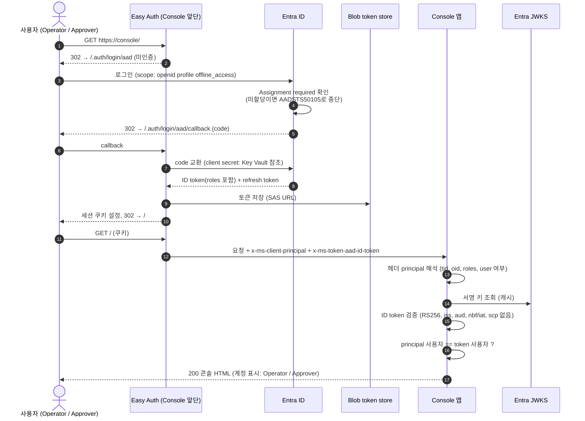
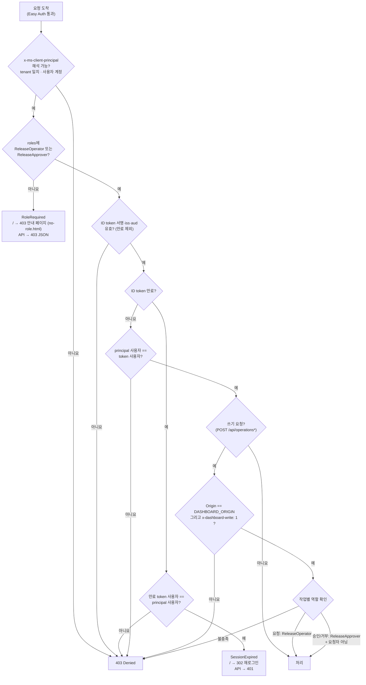
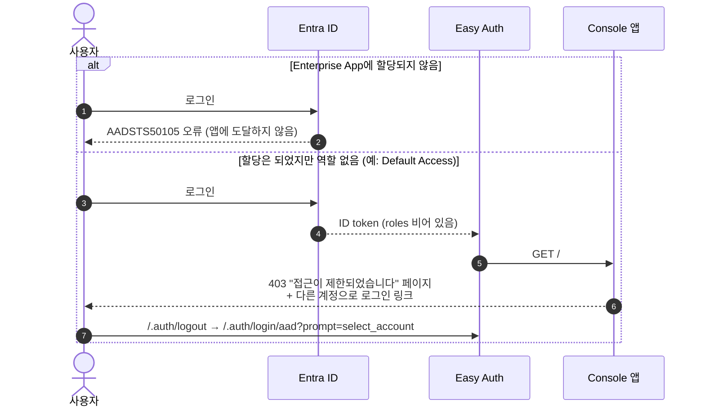
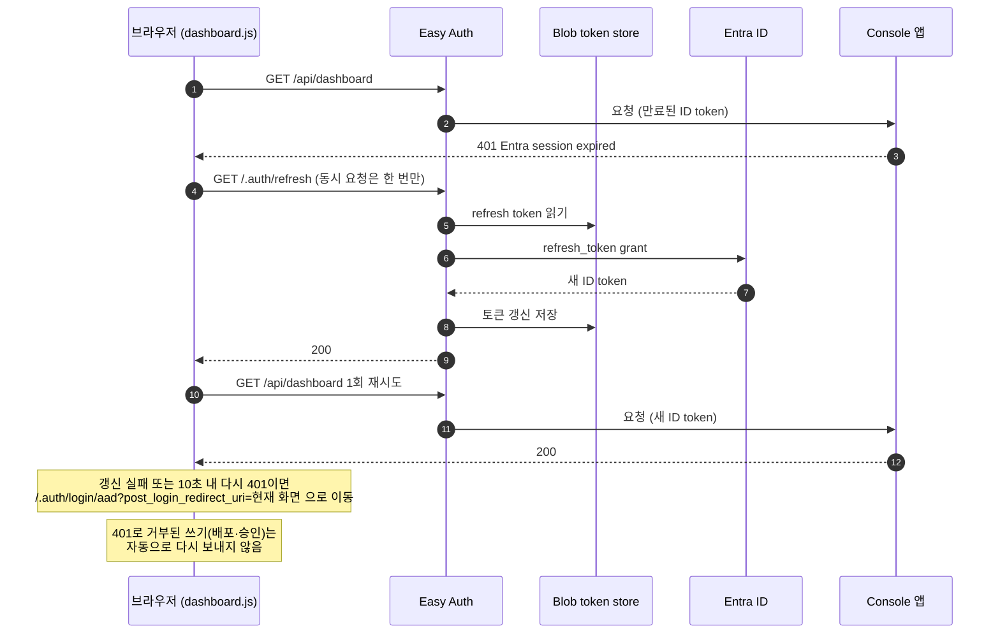
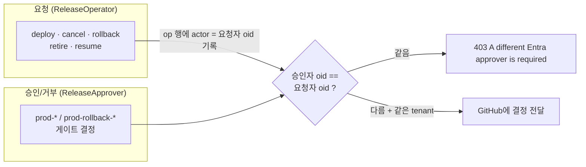

# 3. 인증 흐름 (Entra 로그인 · 역할 · 세션)

Console의 인증은 두 층으로 이루어집니다.

1. **Easy Auth(플랫폼)**: Entra OIDC 로그인, 토큰 저장(Blob token store), 요청마다 사용자 헤더 주입.
2. **앱(`auth.py`)**: Easy Auth가 넘긴 **사용자 헤더**와 **ID token**을 각각 해석·검증하고, 둘이 같은 사람인지, 어떤 역할을 가졌는지 판단.

Receiver(`/webhooks/github`)에는 Easy Auth가 없고, GitHub 웹훅 HMAC 서명으로만 보호됩니다([4장](04-operation-flows.md)).

## 3.1 Operator / Approver 최초 로그인

Operator와 Approver의 로그인 절차는 같습니다. 차이는 ID token의 `roles` 클레임뿐이며, 화면의 버튼 활성화와 API 허용 범위가 달라집니다.

| 단계 | 운영자 확인 포인트 |
| --- | --- |
| 5 | 할당되지 않은 사용자는 앱에 도달하지 못합니다. 이 오류는 Entra 화면에 표시됩니다. |
| 8 | client secret 만료 시 로그인 전체가 실패합니다. Key Vault secret과 ACA secret 상태를 확인합니다. |
| 10 | SAS 만료(최대 7일) 시 토큰 저장이 실패해 로그인 루프나 500이 발생할 수 있습니다. |
| 14–16 | 다른 테넌트(`tid`), 서비스 주체 토큰(`scp` 포함 또는 `idtyp≠user`), 헤더와 token 사용자 불일치는 모두 403입니다. |

## 3.2 인증·인가 판정 흐름

모든 요청(`/`, `/assets/*`, `/api/*`)에서 앱이 수행하는 판정입니다.

- 쓰기 요청의 `Origin`·`x-dashboard-write` 검사는 다른 사이트에서 사용자의 쿠키로 요청을 보내는 CSRF를 막습니다.
- 응답에는 항상 `Cache-Control: no-store`, CSP(`default-src 'self'`), `frame-ancestors 'none'` 등의 보안 헤더가 붙습니다.

### HTTP 상태 코드 의미

| 코드 | 원인 | 운영자 조치 |
| --- | --- | --- |
| 401 | 같은 사용자의 ID token 만료 | 정상 동작. 브라우저가 자동으로 갱신합니다. 반복되면 token store·SAS 확인 |
| 403 | 역할 없음, 테넌트·사용자 불일치, Origin 불일치, 권한 부족, 자기 승인 | 역할 할당, 접속 URL(사용자 지정 도메인 미지원) 확인 |
| 409 | 같은 결정이 이미 있음, 미해결 쓰기 존재 | [5장](05-deployment-and-ops.md#장애-진단) 참고 |
| 422 | 잘못된 대상, 더 이상 승인 대기 아님, Re-run 승인 시도 | 화면 새로고침 후 재판단 |
| 503 | GitHub/Azure 조회 실패 | 상태 확인 후 재시도. **쓰기 결과를 먼저 확인** |

## 3.3 역할 없는 사용자 / 미할당 사용자

## 3.4 세션 만료와 자동 갱신

ID token은 약 1시간 유효합니다. 로그인 scope에 `offline_access`가 있으므로 token store에 refresh token이 있고, 브라우저는 다음 흐름으로 갱신합니다(`dashboard.js`).

- 만료 상태에서 `/`를 새로 고치면 서버가 `302 /.auth/login/aad?post_login_redirect_uri=/...`로 보냅니다.
- `offline_access` 추가 전에 로그인한 세션은 refresh token이 없어 첫 만료 때 한 번 다시 로그인합니다.
- 확인: 로그인 후 `/.auth/refresh` 200, `/.auth/me`의 ID token 만료 시각 갱신.

## 3.5 직무 분리 (요청자 ≠ 승인자)

| 사용자 | 요청 | 남의 요청 승인 | 자기 요청 승인 |
| --- | :-: | :-: | :-: |
| Operator만 | ✓ | ✗ | ✗ |
| Approver만 | ✗ | ✓ | — |
| 둘 다 | ✓ | ✓ | ✗ |

이전: [2. 플랫폼 구성](02-platform-configuration.md) · 다음: [4. 작업 흐름](04-operation-flows.md)
