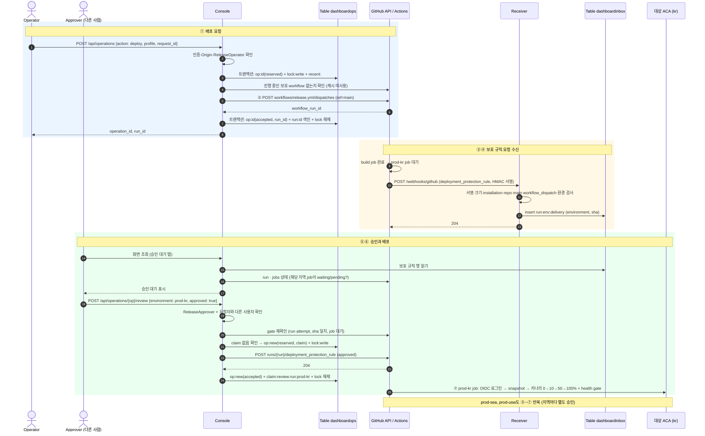
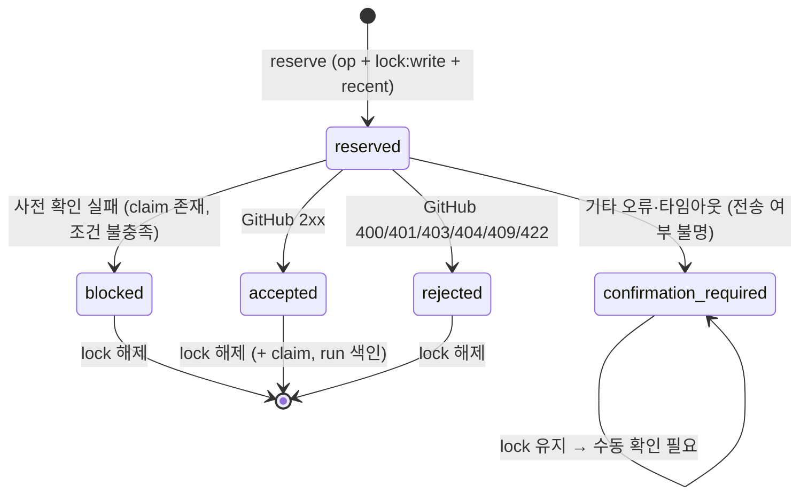
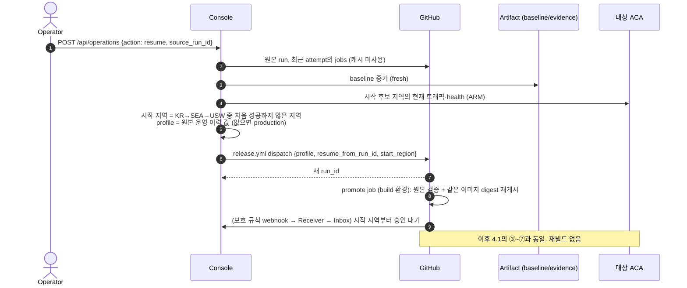
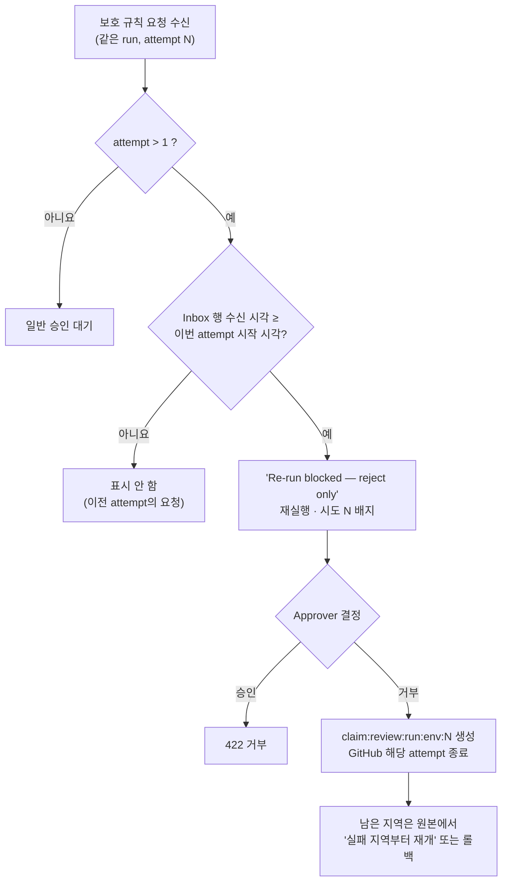
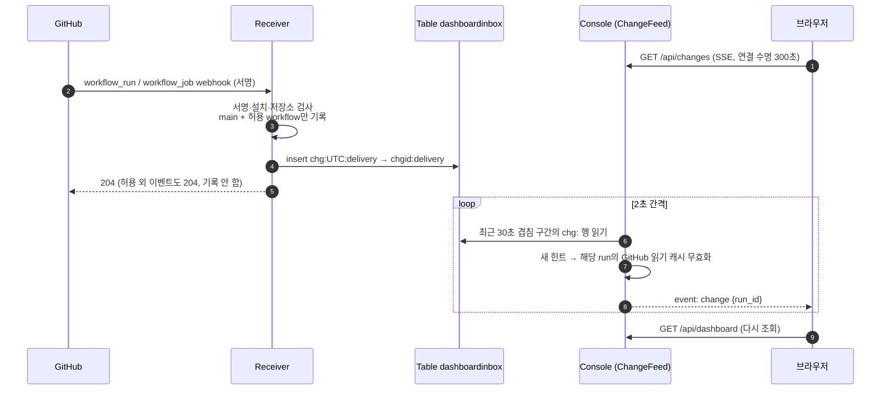
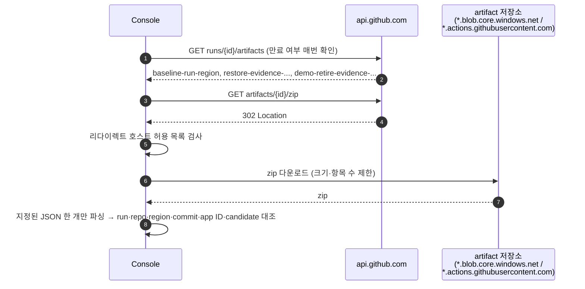

# 4. 작업 흐름 (요청 · 승인 · 변경 알림)

이 장은 관제실의 핵심 흐름을 시퀀스로 설명합니다. 공통 원칙은 다음과 같습니다.

- **Console은 요청과 결정만 GitHub에 전달**하고, Azure 변경은 GitHub Actions workflow가 OIDC로 수행합니다.
- **쓰기는 한 번에 하나**(`lock:write`)만 진행되며, 같은 결정은 `claim:` 행으로 한 번만 허용됩니다.
- 쓰기 직전에는 **캐시를 쓰지 않고** GitHub·artifact 증거·Azure를 다시 읽어 조건을 확인합니다.
- 웹훅은 **신호**일 뿐 권한 근거가 아닙니다. 승인 가능 여부는 서명된 보호 규칙 행 + GitHub job 상태 + 관제실 작업 기록을 함께 확인해 판단합니다.

## 4.1 배포 요청 → 지역 승인 (end-to-end)

| 단계 | 실패 시 결과 | 운영 포인트 |
| --- | --- | --- |
| 3 | `lock:write`가 이미 있으면 409 | 미해결 쓰기가 남아 있는지 확인 |
| 4 | 다른 보호 workflow 진행 중이면 422, op는 `blocked` | 동시 배포 방지 |
| 5–6 | GitHub 4xx → `rejected`, 그 외 오류 → `confirmation_required`(잠금 유지) | **자동 재시도하지 않음** |
| 10–11 | 서명 실패·다른 저장소·허용되지 않은 환경 → 403, Inbox에 기록하지 않음 | GitHub App의 Recent Deliveries 확인. 자동 재전송 없음 → 필요 시 수동 Redeliver |
| 19 | 요청자 본인 → 403 | 다른 Approver 필요 |
| 20 | 더 이상 대기 아님 → 422 | 이미 결정·취소되었거나 job이 진행 중 |
| 21 | 같은 결정 존재 → 409 | 중복 클릭·다중 승인자 경합 차단 |

## 4.2 작업 상태 (op 행)

- `accepted`는 "GitHub가 요청을 접수했다"는 뜻이지 **배포 성공이 아닙니다**. 결과는 GitHub 실행과 Azure 트래픽으로 확인합니다.
- `confirmation_required`나 `reserved`에 머무르면 새 쓰기가 모두 막힙니다. 정정 절차는 [7장 문제 해결](../07-deployment-dashboard.md#운영-중-문제-해결)을 따릅니다.

## 4.3 작업 종류별 매핑

| 작업 (UI) | 역할 | 호출 | 입력 | 게이트 환경 | 사전 확인 (쓰기 시점) |
| --- | --- | --- | --- | --- | --- |
| 새 배포 | Operator | `release.yml` dispatch | `profile` (demo/production) | `prod-kr` → `prod-sea` → `prod-usw` | 진행 중인 보호 workflow 없음 |
| 실행 취소 | Operator | `POST runs/{id}/cancel` | `source_run_id` | — | 원본이 main `release.yml`이고 미완료, `claim:cancel:<run>` 없음 |
| 롤백 요청 | Operator | `restore.yml` dispatch | `source_run_id`, `region` | `prod-rollback-<region>` | 원본 완료, baseline artifact 검증, Azure 현재 트래픽 대조 |
| 이전 리비전 종료 (Retire) | Operator | `demo-retire.yml` dispatch | `source_run_id`, `region` | `retire-<region>` (**GitHub에서 승인**) | 원본 완료, 증거·트래픽 대조, demo 프로필만 |
| 실패 지역부터 재개 | Operator | `release.yml` dispatch | `profile`, `resume_from_run_id`, `start_region` (**서버가 결정**) | 시작 지역부터 `prod-*` | 원본 실패/취소, 앞 지역 성공, 시작 지역 트래픽이 정상 리비전 하나에 100% |
| 승인 / 거부 | Approver | `POST runs/{id}/deployment_protection_rule` | `environment`, `state` | — | 요청자와 다른 사람, 대기 중, 같은 sha, 같은 attempt, claim 없음 |

## 4.4 실패 지역부터 재개

## 4.5 GitHub Re-run 거부 흐름

GitHub UI에서 Re-run하면 같은 run ID의 attempt ≥ 2가 생깁니다. 배포 job은 attempt 1만 허용하므로 관제실은 이 게이트를 **거부만** 할 수 있게 합니다.

## 4.6 실시간 변경 알림 (`workflow_run` / `workflow_job`)

- 허용 workflow: `release.yml`, `release-kr.yml`, `restore.yml`, `demo-retire.yml` (job 이벤트는 workflow 표시 이름으로 판단).
- 웹훅이 없어도 화면은 폴링(진행 중 약 5초, 유휴 30–60초)으로 갱신됩니다. 진행 중인데 15분 넘게 힌트가 없으면 **변경 알림** 칩이 오래됨으로 표시됩니다.
- 화면 조회용 GitHub 캐시: 진행 중 run 약 5초, 완료 run 약 5분(ETag 조건부 재조회). 쓰기 요청 직후 해당 run 캐시는 즉시 무효화됩니다.

## 4.7 증거(artifact) 조회

롤백·Retire·재개 가능 여부는 workflow가 남긴 artifact로 판단합니다.

- 화면 조회에서는 파싱 결과를 캐시하지만, **쓰기 시점에는 항상 새로 읽습니다**(`fresh=True`).
- artifact가 만료되면 롤백·재개 버튼이 사유와 함께 비활성화됩니다.

이전: [3. 인증 흐름](03-auth-flows.md) · 다음: [5. 배포와 운영](05-deployment-and-ops.md)
