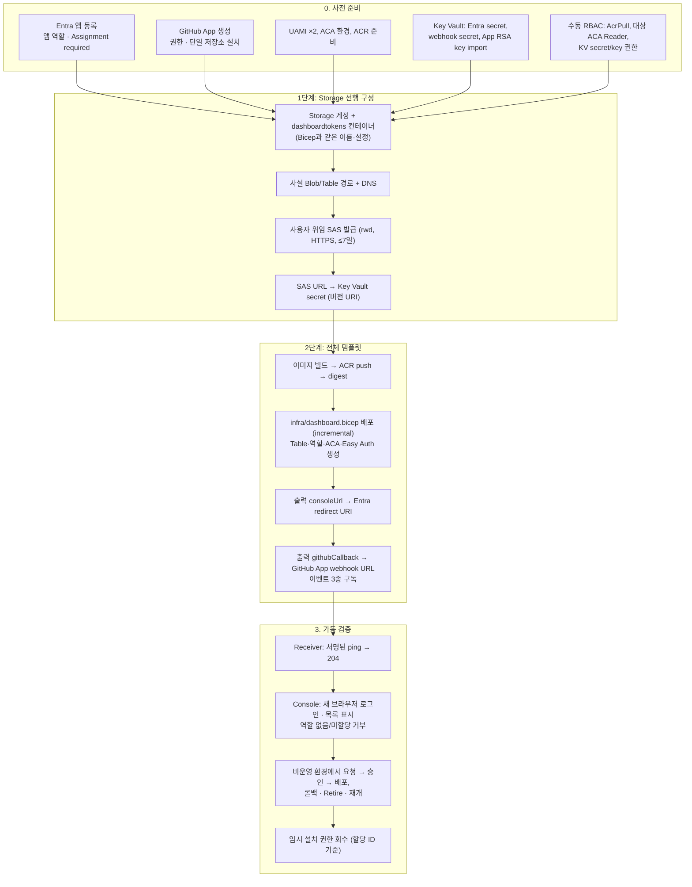
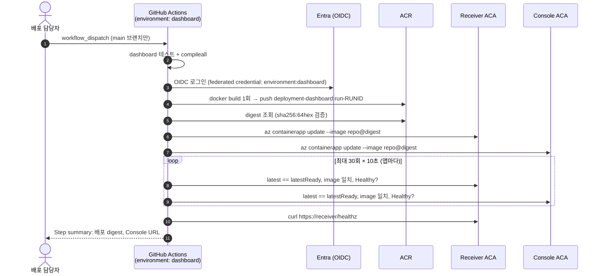
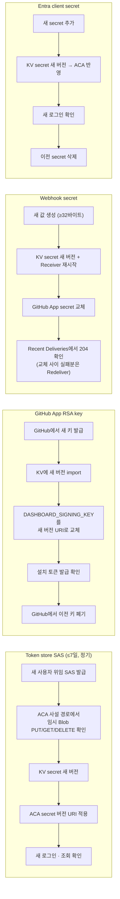
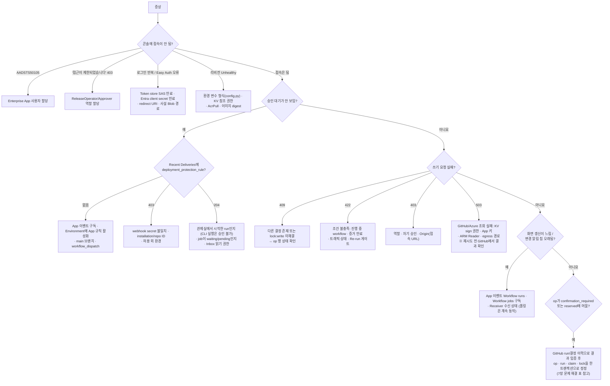

# 5. 배포와 운영

이 장은 관제실 자체의 설치·이미지 갱신·비밀 회전·장애 진단을 다룹니다. 명령어 수준의 절차는
[7장 사전 준비](../07-deployment-dashboard.md#사전-준비)와 [8장 권한 체크리스트](../08-deployment-dashboard-permissions.md)를 따릅니다.

## 5.1 최초 설치 흐름

Easy Auth token store가 **SAS URL이 있는 기존 Blob 컨테이너**를 요구하므로, 설치는 두 단계로 나뉩니다.

| 주의 | 이유 |
| --- | --- |
| Key Vault RBAC 전파를 기다린 뒤 ACA를 배포 | ACA secret 참조가 권한 부족으로 실패하면 리비전이 기동하지 않음 |
| 사설 전용 설치면 재배포 전에 템플릿의 `publicNetworkAccess`를 `Disabled`로 맞춤 | 템플릿이 Storage 설정을 다시 적용 |
| `ping` 204만으로 승인 경로를 입증하지 않음 | 보호 규칙 이벤트는 실제 Environment 규칙이 있어야 발생 |
| GitHub `Required reviewers` 대체는 비운영 검증 후 | 기존 보호 설정을 기록해 두고 되돌릴 수 있게 함 |

## 5.2 이미지 갱신 (`dashboard-deploy.yml`)

인프라·비밀·Easy Auth는 바꾸지 않고 **두 ACA의 이미지 digest만** 교체합니다.

- 순서는 **Receiver → Console**입니다. 같은 digest를 사용하므로 두 앱의 코드 버전이 어긋나지 않습니다.
- `concurrency: deployment-dashboard`로 동시 실행을 막습니다. 실패해도 이전 리비전 자동 복구는 없으므로, 필요하면 이전 digest로 다시 `az containerapp update`합니다.
- Single revision 모드이므로 새 리비전이 Ready가 되면 트래픽이 전환됩니다. SSE 연결은 끊기고 브라우저가 자동 재연결합니다.

## 5.3 비밀·키 회전

| 대상 | 주기·트리거 | 실패 시 증상 |
| --- | --- | --- |
| Token store SAS | 최대 7일 → 만료 전 | 로그인 후 토큰 저장 실패, `/.auth/refresh` 실패, 로그인 반복 |
| GitHub App RSA key | 조직 정책 / 유출 의심 | 모든 GitHub 호출 503, 화면 GitHub 칩 오류 |
| Webhook secret | 조직 정책 / 유출 의심 | Receiver 403, 승인 대기 미표시 |
| Entra client secret | 만료일 전 | 로그인 실패 (Easy Auth 오류) |

SAS 원문, 키, secret 값은 로그·파일·채팅에 남기지 않습니다.

## 5.4 상태 확인 지점

| 대상 | 확인 | 정상 |
| --- | --- | --- |
| Console 리비전 | `az containerapp revision list` | Healthy, Running |
| Receiver | `GET https://<receiver>/healthz` | `{"ok": true}` |
| Receiver 수신 | GitHub App → Advanced → Recent Deliveries | 204 |
| Easy Auth | 로그인 후 `/.auth/me`, `/.auth/refresh` | 200, ID token 만료 시각 갱신 |
| 화면 칩 | GitHub · 운영 이력 · Azure 지역 · 레플리카 표본 · 변경 알림 | "n초 전", 강조 없음 |
| 쓰기 잠금 | `dashboardops`의 `lock:write` 행 | 평소 없음 |

## 장애 진단

| 증상 | 1차 확인 | 근거 |
| --- | --- | --- |
| 레플리카 표본이 비어 있음 | 대상 앱이 internal ingress이거나 Console egress 차단 | `observations.py` (리비전 FQDN 조회) |
| Azure 지역 칩 오류 | Console UAMI의 대상 ACA `Reader`, `management.azure.com` egress | `observations.py` |
| 롤백 버튼 비활성 "baseline unavailable" | artifact 만료, 원본 run 불일치 | `evidence.py` |
| 승인에 "Re-run blocked — reject only" | 누군가 GitHub에서 Re-run 함 → 거부 후 재개 사용 | [4.5](04-operation-flows.md#45-github-re-run-거부-흐름) |

관제실 장애·보호 규칙 이상 시에는 기존 안전장치를 삭제하지 말고 변경 요청을 멈춘 뒤, 미리 승인된 별도 승인 경로와 기존 runbook([4장 운영 runbook](../04-operations-runbook.md))을 따릅니다.

이전: [4. 작업 흐름](04-operation-flows.md) · 처음: [README](README.md)
