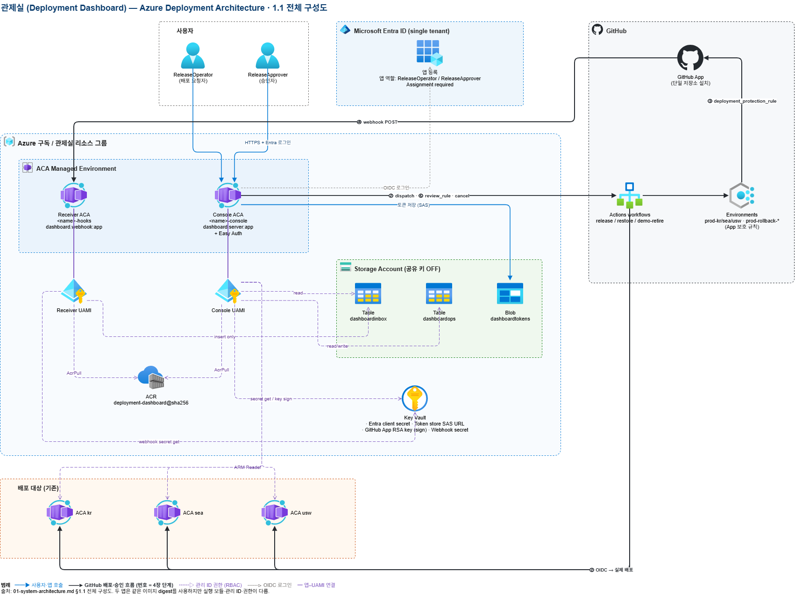
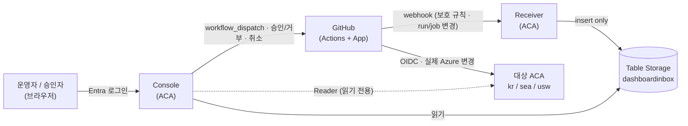

# 배포 관제실(Deployment Dashboard) 아키텍처 가이드 — 인프라 운영자용

이 폴더는 `dashboard\` 앱(배포 관제실 Console + GitHub 웹훅 Receiver)을 **인프라 운영자 시각**에서
그림으로 설명합니다. "어떤 구성요소가, 어떤 ID로, 어디에, 무엇을 호출하는가"를 중심으로
Azure · Microsoft Entra ID · GitHub의 구성과 주요 흐름을 Mermaid 다이어그램으로 정리했습니다.

> 화면 사용법과 단계별 설치 명령은 [7장 관제실 운영 가이드](../07-deployment-dashboard.md),
> 권한 할당·회수 체크리스트는 [8장 권한 체크리스트](../08-deployment-dashboard-permissions.md)를 기준으로 합니다.
> 이 폴더는 그 내용을 **구조와 흐름** 관점에서 보완합니다.

## 문서 지도

| 문서 | 무엇을 알 수 있나 | 주요 다이어그램 |
| --- | --- | --- |
| [01-system-architecture.md](01-system-architecture.md) | 전체 구성요소, 책임 경계, 네트워크·호출 방향, 리소스별 주요 설정 | 시스템 구성도, 호출 방향(Ingress/Egress) |
| [02-platform-configuration.md](02-platform-configuration.md) | Azure / Entra / GitHub 각각의 구성·설정 항목과 검증 방법, ID·RBAC 매트릭스 | 권한 그래프, GitHub App 토큰 발급, Environment 보호 구성 |
| [03-auth-flows.md](03-auth-flows.md) | Operator·Approver 로그인, 역할 없음, 세션 만료 갱신, 직무 분리 | 로그인 시퀀스, 인증 판정 흐름 |
| [04-operation-flows.md](04-operation-flows.md) | 배포 요청 → 보호 규칙 → 승인 → 배포, 취소·롤백·Retire·재개, 실시간 변경 알림 | 배포·승인 시퀀스, 작업 상태도 |
| [05-deployment-and-ops.md](05-deployment-and-ops.md) | 최초 설치, 이미지 갱신, 비밀·키 회전, 장애 진단 | 설치 흐름, 이미지 배포 시퀀스, 트러블슈팅 결정 트리 |

읽는 순서: 처음이면 01 → 02 → 03 → 04 → 05. 장애 대응 중이면 [05의 장애 진단](05-deployment-and-ops.md#장애-진단)부터 봅니다.

## 한 장 요약

핵심 원칙 세 가지:

1. **관제실은 Azure 대상 앱을 직접 변경하지 않습니다.** Azure 쓰기는 항상 기존 GitHub Actions workflow(OIDC)가 수행합니다. 관제실은 "요청"과 "승인"만 GitHub에 전달합니다.
2. **두 개의 ACA, 두 개의 관리 ID로 권한을 분리합니다.** 인터넷에서 웹훅을 받는 Receiver는 Inbox에 "추가"만 할 수 있고, GitHub App 서명 키에 접근할 수 없습니다.
3. **사람의 승인은 Entra 역할로, 배포 게이트는 GitHub App custom protection rule로** 구현합니다. 요청자는 자기 요청을 승인할 수 없습니다.

## 용어집

| 용어 | 의미 |
| --- | --- |
| Console (관제실) | `<name>-console` Container App. 운영자 UI와 API(`/api/*`)를 제공. 모듈 `dashboard.server:app` |
| Receiver (수신기) | `<name>-hooks` Container App. GitHub App 웹훅만 수신(`/webhooks/github`). 모듈 `dashboard.webhook:app` |
| Easy Auth | ACA 내장 인증(`authConfigs`). Console 앞단에서 Entra 로그인을 처리하고 `x-ms-client-principal`, `x-ms-token-aad-id-token` 헤더를 앱에 전달 |
| Token store | Easy Auth가 사용자 토큰(refresh token 포함)을 보관하는 private Blob 컨테이너 `dashboardtokens` (SAS URL로 접근) |
| `ReleaseOperator` | 배포·취소·롤백·Retire·재개를 **요청**할 수 있는 Entra 앱 역할 |
| `ReleaseApprover` | 다른 사람이 요청한 실행의 지역 게이트를 **승인/거부**할 수 있는 Entra 앱 역할 |
| GitHub App | 관제실 전용 App. `Actions: read/write`, `Deployments: read/write`. custom deployment protection rule 제공자 |
| Protection rule (보호 규칙) | GitHub Environment(`prod-kr` 등)에 연결된 App 규칙. job이 해당 환경에 들어가기 전 App에 `deployment_protection_rule` 웹훅을 보내고 App의 승인/거부를 기다림 |
| Inbox | Table `dashboardinbox`. Receiver가 검증한 보호 규칙 요청 행과 변경 힌트(`chg:`) 행 |
| Operations table | Table `dashboardops`. 관제실 작업 감사 행(`op:`), 쓰기 잠금(`lock:write`), 중복 결정 방지(`claim:`), 색인(`recent:`, `run:`) |
| Claim | 같은 결정이 두 번 실행되지 않도록 하는 행. 예: `claim:review:<run>:<env>[:<attempt>]`, `claim:cancel:<run>` |
| Evidence (증거) | workflow가 남긴 artifact(`baseline-*`, `restore-evidence-*` 등). 롤백·재개 가능 여부 판단에 사용 |
| 변경 힌트 | `workflow_run`/`workflow_job` 웹훅으로 생긴 "run X 바뀜" 신호. 캐시 무효화와 화면 새로고침에만 사용하며 판단 근거가 아님 |
| 실패 지역부터 재개 | 실패/취소된 릴리스를 GitHub Re-run 없이 새 `release.yml` 실행으로 남은 지역부터 배포 ([ADR 0001](../../docs/adr/0001-rerun-prohibition-and-region-resume.md)) |

## 근거 소스

| 영역 | 파일 |
| --- | --- |
| 인프라 | `infra\dashboard.bicep` |
| 이미지 배포 | `.github\workflows\dashboard-deploy.yml`, `dashboard\Dockerfile` |
| 인증 | `dashboard\auth.py`, `dashboard\server.py` |
| GitHub 연동 | `dashboard\github.py`, `dashboard\webhook.py` |
| 작업/승인 | `dashboard\operations.py`, `dashboard\observations.py`, `dashboard\store.py`, `dashboard\changes.py`, `dashboard\evidence.py` |
| 설정 검증 | `dashboard\config.py` |
